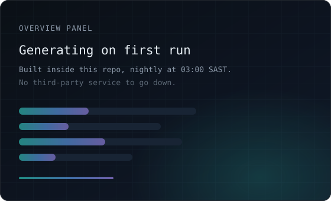
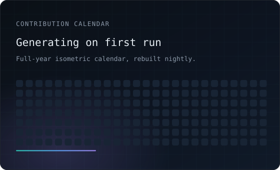

<div align="center">



<br>

[](#)
[](#)
[](#)
[](https://inunu.net)

</div>

---

### `$ cat about.md`

I build **autonomous agents and the systems they live in** — software that holds a memory,
forms a view of the person it works for, and acts without being asked twice.

Most of it runs on your own machine. Local models before paid APIs, your data in your own
storage, every side-effecting action logged with the reasoning behind it. Privacy isn't a
feature I bolt on at the end; it's the constraint I design from.

```ts
const vilis = {
  building:  ["autonomous agents", "memory architectures", "local-first apps"],
  stack:     ["TypeScript", "Node", "Next.js", "Python", "Ollama"],
  principle: "if it can run on your hardware, it should",
  askMeAbout: "agent tool-use, long-term memory design, running LLMs offline",
};
```

---

### `$ ls -la ~/builds`

| Project | What it is | Stack |
|---|---|---|
| **Sereia** | A private, Telegram-first personal AI agent with her own personality — 57 tools, multi-step autonomy, evidence-based long-term memory, and an interest graph she builds herself. Runs entirely on local models. | `TypeScript` `Node` `Ollama` |
| **Yuna** | An AI companion built on a formally specified memory architecture — four memory layers, 35 lifecycle invariants, emergent personality bounded against drift. Designed before it was coded, and audited after. | `TypeScript` `Firestore` |
| **Anodos** | A local-first desktop personal operating system: habits, tasks, health, goals and analytics in one place, with nothing leaving the machine. | `TypeScript` `Electron` |
| **SchoolFolio** | A student portfolio where teachers get per-project access — authorization enforced at the database rules layer, not the UI. | `Next.js` `Firebase` |

<sub>Most of my work lives in private repos. The ones above are the ones worth asking about.</sub>

---

### `$ stack --list`

<div align="center">


</div>

---

### `$ git log --oneline | wc -l`

<div align="center">




<br><br>


</div>

<div align="center"><sub>Panels above are generated inside this repo on a schedule — no third-party service to go down.</sub></div>

---

### `$ ./snake --eat-contributions`

<div align="center">

<picture>
  <source media="(prefers-color-scheme: dark)" srcset="https://raw.githubusercontent.com/L33B0mb/L33B0mb/output/snake-dark.svg">
  <source media="(prefers-color-scheme: light)" srcset="https://raw.githubusercontent.com/L33B0mb/L33B0mb/output/snake.svg">
  
</picture>

</div>

---

<div align="center">

### `$ contact --open`

[](mailto:brad@inunu.net)
[](https://inunu.net)

<sub>Open to interesting problems — especially the ones that have to run offline.</sub>

</div>
